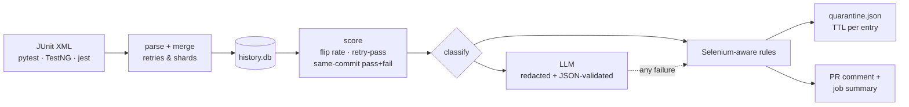
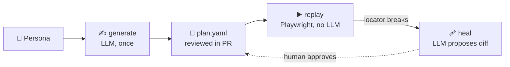
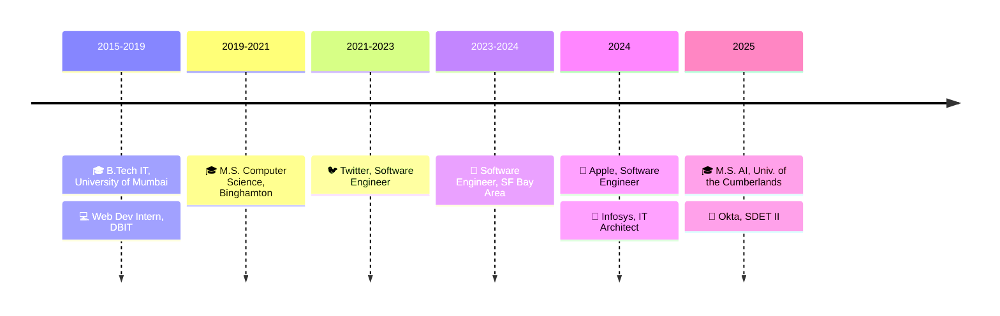

<!-- ═══════════════════════════ HEADER ═══════════════════════════ -->
<p align="center">
  
</p>

<p align="center">
  <a href="https://github.com/baggy2797">
    
  </a>
</p>

<p align="center">
  
  
  
  
  
  
</p>

<p align="center">
  <a href="https://www.linkedin.com/in/adibhagwat/"></a>
  <a href="mailto:bhagwataditya226@gmail.com"></a>
</p>

<p align="center">
  <b>🧭 Jump to:</b>
  <a href="#-the-lab">🛠 The Lab</a> •
  <a href="#-quest-log">🗺 Quest Log</a> •
  <a href="#-the-archive">📦 Archive</a> •
  <a href="#-inventory">🎒 Inventory</a> •
  <a href="#-by-the-numbers">📊 Stats</a> •
  <a href="#-bonus-round">🎲 Bonus</a>
</p>


## 🧙 About me

<table>
<tr>
<td width="60%" valign="top">

I build the machinery that says **"yes, ship it"**, or more often, **"absolutely not, here's why"**.

That's five years of end-to-end automation for **iOS, Android, web and APIs** at Twitter, Apple and now Okta, where a bug can lock someone out of everything.

Lately I've been chasing one question:

> **Where does an LLM actually help QA, and where does it just add more flakiness?**

Everything in **The Lab** below is an attempt to answer it.

</td>
<td width="40%" valign="top">

```yaml
name: Aditya Bhagwat
role: SDET II @ Okta
based_in: Bengaluru, India
degrees:
  - M.S. Artificial Intelligence
  - M.S. Computer Science
  - B.Tech Information Technology
focus:
  - mobile + web E2E automation
  - CI reliability & security
  - LLMs for testing
fuel: ☕ + ⚽
```

</td>
</tr>
</table>


## 🛠 The Lab

<p align="center"><i>Four tools that each fix one annoying part of test infrastructure, plus a demo that wires them together.</i><br><sub>🔒 = private while I polish it · ↗ = public</sub></p>

<table>
<tr>
<td width="50%" valign="top">

### 🧪 flakewatch 🔒
**A detective for flaky tests.**
Reads the JUnit XML your CI already produces, scores every test across runs, and explains *why* each one is flaky with Selenium-aware rules and an optional LLM. Then it quarantines tests with an expiry date.


</td>
<td width="50%" valign="top">

### 🧭 journeyprobe 🔒
**Persona tests written by an LLM, replayed without one.**
*"Maya, a budget-conscious student, wants a mug"* becomes a reviewable YAML plan. Playwright replays it deterministically, and broken locators get suggested fixes as a diff that's never applied automatically.


</td>
</tr>
<tr>
<td width="50%" valign="top">

### 🛡 hardened-actions-template 🔒
**Least-privilege CI you can copy.**
SHA-pinned actions and locked-down permissions, scanned by zizmor, CodeQL, gitleaks and Trivy. Includes `audit.py`, a stdlib-only auditor that checks *any* repo's workflows and runs on the template itself.


</td>
<td width="50%" valign="top">

### ⏰ token-expiry-watch 🔒
**No more 3 a.m. "token expired" failures.**
A GitHub Action that reads a token's expiry header and fails the build, or opens an issue, *N days before* the token expires. Handles multiple named tokens and providers other than GitHub.


</td>
</tr>
<tr>
<td width="50%" valign="top">

### 🎛 qa-suite-demo 🔒
**All four tools, one pipeline.**
An offline end-to-end harness: journeyprobe → flakewatch → token-expiry-watch → hardened-actions-template. You can watch the whole QA loop run without cloud credentials.


</td>
<td width="50%" valign="top">

### 🛒 [LLM-Selenium-ecommerce ↗](https://github.com/baggy2797/LLM-OpenAI-Selenium-ecommerce)
**Plain English in, browser actions out.**
> *"Search for matte lipstick and add the first product to the cart."*

An LLM turns the sentence into structured steps and Selenium executes them. This is the prototype that grew into journeyprobe.


</td>
</tr>
</table>

<details>
<summary><b>🔬 Deep dive: how flakewatch works</b> (click to expand)</summary>

<br>



It catches `StaleElementReferenceException`, `TimeoutException`, `ElementClickInterceptedException` and others. "Is this really a stale-element race?" is usually the first question UI teams ask.

</details>

<details>
<summary><b>🔬 Deep dive: journeyprobe's author → replay → heal loop</b> (click to expand)</summary>

<br>



```yaml
- name: 'maya: Buy a ceramic mug'
  steps:
  - {action: search, query: Mug}
  - {action: click, target: {role: link, name: Ceramic Mug}}
  - {action: add_to_cart}
  - {action: assert_text, text: Added to cart}
```

</details>


## 🗺 Quest Log



<table>
<tr>
<th>🏢</th><th>Role</th><th>When</th><th>Highlights</th>
</tr>
<tr>
<td></td>
<td>Software Engineer in Test II</td>
<td>Aug 2025 → now<br><sub>Bengaluru</sub></td>
<td>Testing identity, where a bug can lock someone out of everything. No pressure.</td>
</tr>
<tr>
<td></td>
<td>IT Architect</td>
<td>Oct 2024 → May 2025<br><sub>Austin</sub></td>
<td>Architecture and delivery for enterprise clients, at the point where test strategy meets system design.</td>
</tr>
<tr>
<td></td>
<td>Software Engineer</td>
<td>Mar 2024 → Sep 2024<br><sub>Seattle</sub></td>
<td>End-to-end iOS automation with XCUITest, wired into CI.</td>
</tr>
<tr>
<td></td>
<td>Software Engineer</td>
<td>Feb 2023 → Feb 2024<br><sub>SF Bay Area</sub></td>
<td>🤐 Can't say. It was good though.</td>
</tr>
<tr>
<td></td>
<td>Software Engineer</td>
<td>Jul 2021 → Jan 2023<br><sub>San Francisco</sub></td>
<td>
• E2E framework on <b>XCUITest + Espresso</b>, integrated with Selenium and Appium<br>
• <b>Platform-agnostic test plans</b> driving iOS and Android from one design<br>
• Visual regression testing with <b>Applitools</b>, plus BrowserStack and Sauce Labs<br>
• 🏆 <b>Tweeps' Choice Award</b> at HackWeek 2021 with the Music Spaces team
</td>
</tr>
<tr>
<td></td>
<td>Website Developer Intern</td>
<td>Jun 2018 → Jan 2019<br><sub>Mumbai</sub></td>
<td>Built pages for the Training & Placement Cell. My first time shipping to real users.</td>
</tr>
</table>


## 📦 The Archive

<details>
<summary><b>Grad school and side projects</b> (click to open the vault 🗝)</summary>

<br>

| Project | What it does | Stack |
|---|---|---|
| [📺 TV Shows Muster & Analysis](https://github.com/baggy2797/TV-Shows-Muster-and-Analysis) | Sentiment analysis, topic modeling and social-network analysis of tweets and IMDb reviews, with a web dashboard. Team project. | Python · NLP · Jupyter |
| [💳 Credit Card Digit Recognition](https://github.com/baggy2797/Credit-Card-Digit-Recognition-and-Provider-Identification-using-Correlation-based-Template-Matching-) | Finds a card in an image, OCRs all 16 digits with template matching, and identifies Visa, Mastercard or Amex. | OpenCV · Python |
| [🛍 eBay Website Automation](https://github.com/baggy2797/Ebay-Website-Automation) | UI automation suite for eBay flows. | Java · Selenium |
| [💰 CryptoCurrency Tracker](https://github.com/baggy2797/CryptoCurrency-Tracker) | Five CLI apps on the CoinMarketCap API: live prices, portfolio tracking and Excel export. | Python |
| [⭐ Star Wars Tic-Tac-Toe](https://github.com/baggy2797/Star-Wars-Themed-Tic-Tac-Toe) | Tic-tac-toe, but the Force decides. | Python |
| [🧠 Computer Organization & Architecture](https://github.com/baggy2797/Computer-Organization-and-Architecture) | CS 520 coursework at Binghamton. | — |
| [🧩 LeetCode](https://github.com/baggy2797/Leetcode) | Interview prep, preserved in amber. | Java · Python |

</details>

## 🎒 Inventory

<p align="center">
  
</p>

<table align="center">
<tr><td><b>📱 Mobile</b></td><td>XCUITest · Espresso · Appium</td></tr>
<tr><td><b>🌐 Web</b></td><td>Selenium · Playwright</td></tr>
<tr><td><b>👀 Visual / devices</b></td><td>Applitools · Sauce Labs · BrowserStack</td></tr>
<tr><td><b>☁️ Cloud</b></td><td>AWS Lambda · API Gateway · SQS · DynamoDB</td></tr>
<tr><td><b>🔁 CI/CD + security</b></td><td>Jenkins · GitHub Actions · Docker · CodeQL · gitleaks · Trivy</td></tr>
<tr><td><b>🔌 API + tooling</b></td><td>REST · Postman · TestRail · Git</td></tr>
<tr><td><b>🤖 AI</b></td><td>LLMs · Generative AI · OpenAI + Anthropic APIs · AI ethics</td></tr>
<tr><td><b>🗣 Spoken</b></td><td>English · Hindi · Marathi · a little Sanskrit</td></tr>
</table>

## 📊 By the numbers

<p align="center">
  
  
</p>
<p align="center">
  
</p>
<p align="center">
  
</p>

## 🎲 Bonus round

<p align="center"><i>Click to reveal 👇</i></p>

<details>
<summary>❓ <b>What's my favorite sound?</b></summary>
<br>🐞➡️✅ A red test turning green. A close second: a flaky test getting quarantined with an expiry date.
</details>

<details>
<summary>❓ <b>What's my most dangerous topic of conversation?</b></summary>
<br>⚽ Football. I can do 24 hours on it. Bring a chair.
</details>

<details>
<summary>❓ <b>What do I believe?</b></summary>
<br>🌏 <i>वसुधैव कुटुम्बकम्</i>: the world is one family. So say hi, I like meeting new people.
</details>

<br>

<p align="center">
  <b>Got a flaky test, a wild idea, or a hot football take?</b><br><br>
  <a href="https://www.linkedin.com/in/adibhagwat/"></a>
</p>


