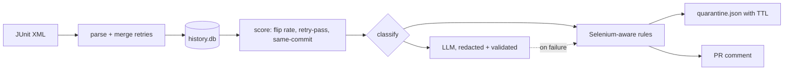
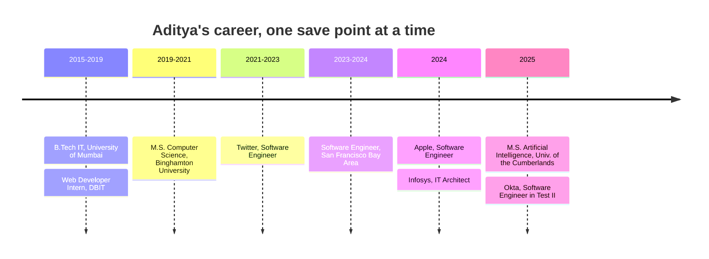

<div align="center">

<a href="https://github.com/baggy2797">
  
</a>

**Software Engineer in Test II @ Okta** · 📍 Bengaluru, India
*M.S. Artificial Intelligence · M.S. Computer Science · a lifelong football problem* ⚽

[](https://www.linkedin.com/in/adibhagwat/)
[](mailto:bhagwataditya226@gmail.com)

**🧭 Pick a path:**
[🛠 The Lab](#-the-lab-what-im-building) ·
[🗺 Quest Log](#-quest-log) ·
[📦 Older Builds](#-the-archive) ·
[🎒 Inventory](#-inventory) ·
[🎲 Fun](#-bonus-round)

</div>

---

## 🧙 TL;DR

I build the machinery that says *"yes, ship it"*, or more often, *"absolutely not, here's why"*.
That's five years of E2E automation for iOS, Android, web and APIs at Twitter, Apple and now Okta.
Lately I've been asking one question: **where does an LLM actually help QA, and where does it just add flakiness?**
Everything in The Lab is an attempt to answer it.

---

## 🛠 The Lab: what I'm building

> Four tools that each fix one annoying part of test infrastructure, plus a demo that runs them together.
> 🔒 = private while I polish it. Click any card to open it.

<details>
<summary><b>🧪 flakewatch</b>: a detective for flaky tests &nbsp;<code>Python</code> <code>SQLite</code> <code>Docker</code> <code>GitHub Action</code> <code>Anthropic</code> 🔒</summary>

<br>

**The problem:** a test fails, you rerun it, it passes, and nobody knows why. Repeat until the team ignores red builds.

**What it does:** reads the JUnit XML your CI already produces (pytest, TestNG/Surefire, jest) across many runs. It builds a history in SQLite and scores each test by flip rate, pass-after-retry, and pass/fail on the same commit. Then it classifies *why* each test is probably flaky.

- 🕵️ Selenium-aware rules catch `StaleElementReferenceException`, `TimeoutException`, `ElementClickInterceptedException` and others. "Is this really a stale-element race?" is usually the first question UI teams ask.
- 🤖 There's an optional LLM classifier. Inputs are redacted, outputs are JSON-validated, and it falls back to the rules on any failure.
- 🚧 Quarantined tests get a TTL per entry, so they can't hide forever. It also posts a PR comment and a job summary.



</details>

<details>
<summary><b>🧭 journeyprobe</b>: persona tests written by an LLM, replayed without one &nbsp;<code>Python</code> <code>Playwright</code> <code>OpenAI</code> <code>pydantic</code> 🔒</summary>

<br>

**The idea:** use the LLM where it's good and keep it away from where it hurts.

1. ✍️ **Author (LLM, once):** *"Maya, a budget-conscious student, wants a mug"* becomes a schema-constrained YAML test plan that you review in a PR like any other code.
2. ▶️ **Replay (no LLM):** Playwright runs the plan deterministically, so it's fast, cheap, repeatable and diffable.
3. 🩹 **Heal (optional):** when a locator breaks, the LLM proposes a fix from a DOM snapshot, **as a diff that is never applied automatically**.

```yaml
- name: 'maya: Buy a ceramic mug'
  steps:
  - {action: search, query: Mug}
  - {action: click, target: {role: link, name: Ceramic Mug}}
  - {action: add_to_cart}
  - {action: assert_text, text: Added to cart}
```

</details>

<details>
<summary><b>🛡 hardened-actions-template</b>: least-privilege CI you can copy &nbsp;<code>GitHub Actions</code> <code>Python</code> <code>Security</code> 🔒</summary>

<br>

A "Use this template" repo with a locked-down CI and security baseline:

- 📌 Every third-party action is pinned to a full commit SHA. Every workflow sets `permissions`, `concurrency` and `timeout-minutes`. Checkout always uses `persist-credentials: false`.
- 🔍 The security stack covers zizmor, actionlint, gitleaks, CodeQL, dependency-review, Hadolint and Trivy.
- 🤖 Dependabot has a 7-day cooldown, and auto-merge is limited to non-major updates and off by default.
- 🧾 **`audit.py`** is a single-file, stdlib-only auditor that checks *any* repo's workflows against the same checklist. The template runs it on itself, so CI fails if the template ever drifts.

</details>

<details>
<summary><b>⏰ token-expiry-watch</b>: no more 3 a.m. "token expired" failures &nbsp;<code>JavaScript</code> <code>GitHub Action</code> 🔒</summary>

<br>

PATs and API tokens expire silently, and you find out when a scheduled job starts failing at 3 a.m.
This Action reads the token's expiry header and **fails the step, or opens and updates an issue, N days ahead**. It handles multiple named tokens and custom headers for providers other than GitHub.

```yaml
- uses: baggy2797/token-expiry-watch@v1
  with:
    token: ${{ secrets.MY_PAT }}
    warn-days: 14
    open-issue: true
```

</details>

<details>
<summary><b>🎛 qa-suite-demo</b>: all four tools in one pipeline 🔒</summary>

<br>

An offline end-to-end harness that chains **journeyprobe → flakewatch → token-expiry-watch → hardened-actions-template** into one QA pipeline, so you can see the whole thing work together without cloud credentials.

</details>

<details>
<summary><b>🛒 LLM-OpenAI-Selenium-ecommerce</b>: plain English in, browser actions out &nbsp;<code>Python</code> <code>Selenium</code> <code>OpenAI</code> <a href="https://github.com/baggy2797/LLM-OpenAI-Selenium-ecommerce">↗ public</a></summary>

<br>

> *"Search for matte lipstick and add the first product to the cart."*

An LLM parses natural-language instructions into structured steps, and Selenium WebDriver executes them. It supports personas ("Shopper", "QA") for prompt formatting. This is the prototype that eventually turned into journeyprobe.

</details>

---

## 🗺 Quest Log



<details>
<summary><b>🔐 Okta</b>: Software Engineer in Test II · Aug 2025 → now · Bengaluru</summary>

<br>Testing identity, where a bug can lock someone out of everything. No pressure.
</details>

<details>
<summary><b>🏢 Infosys</b>: Information Technology Architect · Oct 2024 → May 2025 · Austin</summary>

<br>Architecture and delivery for enterprise clients, at the point where test strategy meets system design.
</details>

<details>
<summary><b>🍎 Apple</b>: Software Engineer · Mar 2024 → Sep 2024 · Seattle</summary>

<br>End-to-end test automation for iOS with XCUITest, integrated into CI.
</details>

<details>
<summary><b>💼 Undisclosed</b>: Software Engineer · Feb 2023 → Feb 2024 · SF Bay Area</summary>

<br>🤐 Can't say. It was good though.
</details>

<details>
<summary><b>🐦 Twitter</b>: Software Engineer · Jul 2021 → Jan 2023 · San Francisco</summary>

<br>

- Built an **E2E automation framework on XCUITest and Espresso**, integrated with Selenium and Appium.
- Wrote **platform-agnostic test plans** that drove iOS and Android from one design.
- Layered the framework (tests, methods, helpers, devices) so it stayed simple to maintain.
- Added visual regression testing with **Applitools** (match levels and ignore regions), plus BrowserStack and Sauce Labs.
- 🏆 Won the **Tweeps' Choice Award at HackWeek 2021** with the **Music Spaces** team.

</details>

<details>
<summary><b>🎓 DBIT</b>: Website Developer Intern · Jun 2018 → Jan 2019 · Mumbai</summary>

<br>Built web pages for the Training & Placement Cell. My first time shipping to real users.
</details>

---

## 📦 The Archive

<details>
<summary>Grad school and side projects (click to open)</summary>

<br>

| Project | What it does | Stack |
|---|---|---|
| [📺 TV Shows Muster & Analysis](https://github.com/baggy2797/TV-Shows-Muster-and-Analysis) | Sentiment analysis, topic modeling and social-network analysis of tweets and IMDb reviews, with a web dashboard. Team project. | Python · NLP · Jupyter |
| [💳 Credit Card Digit Recognition](https://github.com/baggy2797/Credit-Card-Digit-Recognition-and-Provider-Identification-using-Correlation-based-Template-Matching-) | Finds a card in an image, OCRs all 16 digits with template matching, and identifies Visa, Mastercard or Amex. | OpenCV · Python |
| [🛍 eBay Website Automation](https://github.com/baggy2797/Ebay-Website-Automation) | UI automation suite for eBay flows. | Java · Selenium |
| [💰 CryptoCurrency Tracker](https://github.com/baggy2797/CryptoCurrency-Tracker) | Five CLI apps on the CoinMarketCap API: live prices, portfolio tracking and Excel export. | Python |
| [⭐ Star Wars Tic-Tac-Toe](https://github.com/baggy2797/Star-Wars-Themed-Tic-Tac-Toe) | Tic-tac-toe, but the Force decides. | Python |
| [🧠 Computer Organization & Architecture](https://github.com/baggy2797/Computer-Organization-and-Architecture) | CS 520 coursework at Binghamton. | — |
| [🧩 LeetCode](https://github.com/baggy2797/Leetcode) | Interview prep, preserved in amber. | Java · Python |

</details>

---

## 🎒 Inventory

<p align="center">
  
</p>

<details>
<summary>Show the full loadout</summary>

```text
languages     → Java · Python · Swift · Objective-C · JavaScript
mobile        → XCUITest · Espresso · Appium
web           → Selenium · Playwright
visual/device → Applitools · Sauce Labs · BrowserStack
cloud         → AWS Lambda · API Gateway · SQS · DynamoDB
ci/cd + sec   → Jenkins · GitHub Actions · Docker · CodeQL · gitleaks · Trivy
api + tools   → REST · Postman · TestRail · Git
ai            → LLMs · Generative AI · OpenAI + Anthropic APIs · AI ethics
spoken        → English · Hindi · Marathi · a little Sanskrit
```

</details>

---

## 🎲 Bonus round

<details>
<summary>❓ <b>Guess my favorite sound</b></summary>
<br>A red test turning green. A close second: a flaky test getting quarantined with a TTL. 🐞➡️✅
</details>

<details>
<summary>❓ <b>What's my most dangerous topic of conversation?</b></summary>
<br>⚽ Football. I can do 24 hours on it. Bring a chair.
</details>

<details>
<summary>❓ <b>What do I believe?</b></summary>
<br>🌏 <i>वसुधैव कुटुम्बकम्</i>: the world is one family. So say hi, I like meeting new people.
</details>

<div align="center">

<br>

**Got a flaky test, a wild idea, or a hot football take?** [Let's talk →](https://www.linkedin.com/in/adibhagwat/) 🙌

</div>
